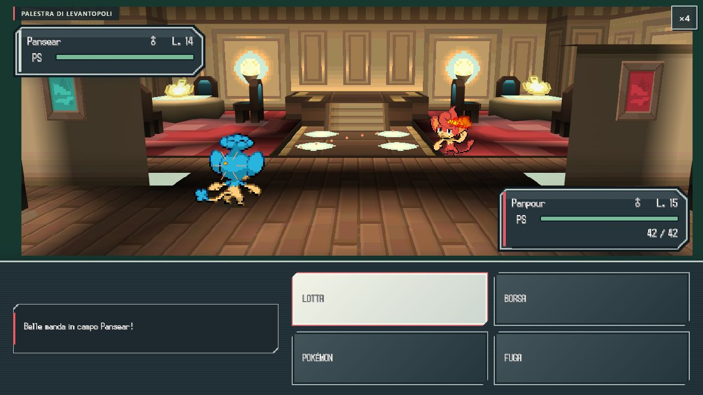

# Verifica di consegna · 0.40

Build Windows `b7fad52e27c0020d`, codice runtime del commit18546db. La successiva archiviazione di questi rapporti non modifica i file del gioco. Il build Linux di Pages può avere un hash diverso per le terminazioni LF; verificare separatamente i file pubblici.

- 211 test Node e3 Python: PASS.
- 13 fasi della suite completa: PASS, [rapporto](qa-040/report.json).
- [Desktop1280×720](qa-040/browser-desktop.json), [verticale390×844](qa-040/browser-portrait.json), [orizzontale844×390](qa-040/browser-landscape.json): PASS, nessun errore non gestito.
- Per formato:25 scene a tre zoom,647 texture GPU confrontate con i PNG,26 atlanti/1.560 campioni,139 coppie Pokémon–mossa/2.780 fotogrammi (due lati e due esiti),9 varianti di fondale del controllo grafico e cicli ambientali completi senza ritagli/sprite vuoti. Le lotte reali del replay aggiungono il loro contesto geografico effettivo.
- Ripristino del contesto GPU due volte per formato, controllo negativo e chiamate Interpoké: PASS. In orizzontale il distacco minimo fra ritratti e dialogo è8px nella prima chiamata e16,40625px nella seconda.
- Replay di palestra/Cantiere con combattimenti effettivi: PASS su desktop e verticale. Scuola, regalo, pulsante errato e tre corretti, due allenatori, Chicco, Medaglia Tris, MT83, Zania/MN01, Taglio, due lotte Plasma, Fumonirico e traguardo C-Gear. La suite CLI prova anche gli altri starter e Capipalestra, scenari di velocità1/2/4, squadra piena, regalo ripetuto, sconfitta e rivincita.

## Errori incontrati e correzioni

Percorsi inizialmente errati dei nuovi sprite corretti e coperti dal controllo di esistenza. Ricezione della medaglia inizialmente non supportata: aggiunti modello, curve e alpha originali con adattamenti dichiarati. La sconfitta eseguiva istruzioni riservate alla vittoria: il blackout ora termina il programma; prove per Capopalestra e N. Il primo layout Interpoké poteva precedere il ResizeObserver: ora viene adattato sincronicamente all’apertura del messaggio.

[Prima prova orizzontale fallita](qa-040/landscape-first-attempt-0775b234fec087c4.json) conservata: include un errore transitorio `MENU_ASSETS` non disponibile e la sovrapposizione Interpoké. Il primo non si è ripresentato dopo ricarica, tre avvii indipendenti del menu con recupero da risorsa mancante e il nuovo controllo completo; la causa iniziale non è stata identificata. Non presentarlo come bug specificamente corretto dal fix Interpoké.

## Limiti

Le coreografie anatomiche, le tende e alcuni dettagli sono adattamenti HD-2D, non una ricostruzione identica DS. Vedere [inventario del capitolo](STRIATON-DREAMYARD-040.md). Nessun confronto udibile, certificazione di GPU Android fisiche o dimostrazione di assenza assoluta di bug. I test usano partite isolate.

