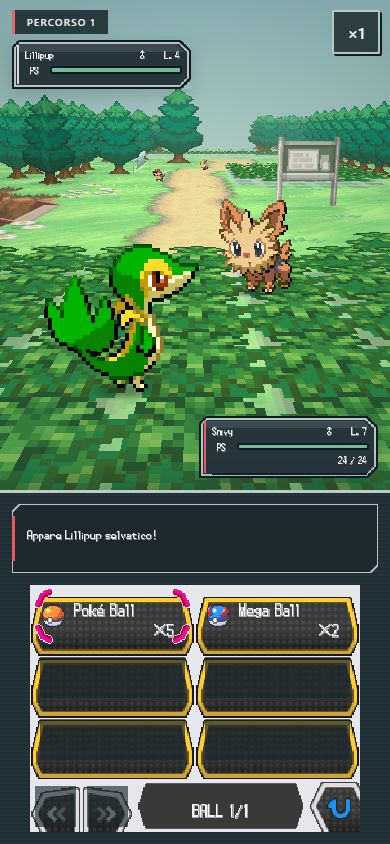
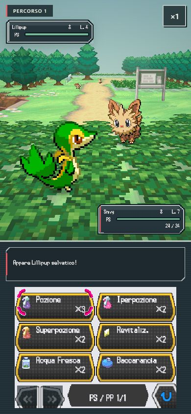

# Correzioni e verifica · 0.41

Build candidata Windows `bface11d1ad31415`. Conserva la progressione 0.40, i salvataggi e le 139 coppie Pokémon–mossa. L’estensione fino a Zefiropoli è richiesta ma non implementata in questa revisione.

## Modifiche

- Borsa di lotta: icone originali per tutti gli strumenti disponibili, nomi e quantità separati, sei spazi con margini per il cursore, spazi vuoti non selezionabili, frecce inattive su una sola pagina e indicatore categoria/pagina. La selezione torna allo strumento precedente dal dettaglio; B e Indietro dal bersaglio conservano la categoria, compresi gli strumenti di stato. Nessuna modifica alle regole di cura o cattura.
- Interpoké: le basi di Alcide/Komor (indici 2/3) usavano gli occhi delle risorse 3/2. Corrette in 2/3 in `tools/extract-phone.py` e rigenerati tutti i 18 PNG. Le tre pose della bocca identiche per questi personaggi sono previste dalle risorse originali, non pose mancanti. Le icone strumenti provengono dalla tabella ARM9 `0x0209eaec` e da `a/0/2/5`.
- Komor: il residente con script 2000 risponde prima del comizio, senza avanzare le variabili del Centro o del Team Plasma. Può essere presente anche prima del completamento della visita al Centro; gli attori della piazza restano soggetti ai loro prerequisiti.
- Attesa eventi: vengono attesi solo i corpi il cui cammino viene effettivamente aggiornato. Un camminatore rimosso dal campo poteva mantenere `phase=4` per sempre. La regressione fallisce sulla 0.40 a tutte e tre le velocità e passa dopo la correzione; non forza un timeout o un teletrasporto.
- Avvio: 136 script e 9 stili entrano da `app.js` e `app.css`; ogni script conserva un distinto elemento classico per preservare ordine e ambiti globali. Il pacchetto `field-pack.bin` contiene 1.687 PNG originali (1.351.785 byte), con indice validato. In caso di pacchetto non disponibile/corrotto si usano le immagini individuali e il tentativo può essere ripetuto. Il numero riguarda il catalogo raggruppato, non una misura dei secondi risparmiati sul telefono fisico.
- Tutorial: ambiente, sprite, cattura ed effetto di Botta vengono preparati in anticipo sul Percorso 1; il caricamento di una lotta prepara in parallelo ambiente e Pokémon e mostra lo stato di caricamento.

## Prove

217 test Node, 3 Python e tutte le 13 fasi della suite completa: PASS sulla build candidata, [rapporto CLI](qa-041/report.json). La regressione sui camminatori non aggiornati e il dialogo di Komor sono inclusi nei rapporti di campo e città. [Desktop 1280×720](qa-041/browser-desktop.json), [verticale 390×844](qa-041/browser-portrait.json) e [orizzontale 844×390](qa-041/browser-landscape.json): PASS, nessun errore non gestito. Per formato: 25 scene a tre zoom, 647 texture GPU confrontate con i PNG, 26 atlanti/1.560 campioni e 139 coppie/2.780 fotogrammi, nove fondali e cicli ambientali. Borsa: quattro categorie, 400 direzioni, annullamento senza consumo, ritorno allo strumento e alla categoria, bersaglio a PS pieni disabilitato. Interpoké: entrambe le chiamate e tutte le espressioni nei tre formati. Due ripristini del contesto GPU per formato: PASS.

Replay reale in verticale a ×4: tutorial, cammino attraverso una cella futura vuota, Aralia al Centro, Komor e Belle nelle destinazioni previste, due cure complete attraverso il bancone: PASS. [Prima prova del replay](qa-041/portrait-itinerary-fixture-first-attempt.json) conservata: falliva perché la precedente anteprima Borsa lasciava aperta una lotta. La fixture ora chiude le anteprime prima di preparare una prova; la [ripetizione pulita](qa-041/portrait-itinerary-clean.json) passa. Il rapporto verticale combina le prove riuscite della stessa build, con i file sorgente elencati: nessun fallimento è cancellato dal materiale di verifica. I primi tentativi e i fallimenti incontrati restano nei rapporti locali; non valgono come esito finale.

## Limiti

Nessun confronto udibile, misurazione su rete mobile fisica o certificazione di GPU Android. La riduzione delle richieste non elimina il tempo di download/decodifica. Le prove automatiche non dimostrano assenza assoluta di bug. Nessun nuovo tratto di storia è dichiarato completato.

